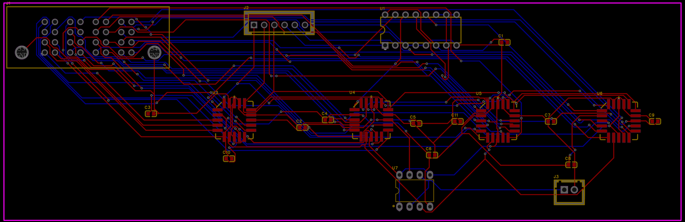

# 32:1 Analog Multiplexer Card

A 32-channel, ±15V analog multiplexer card designed for use in Automated Test Equipment (ATE), built around a 5-bit address bus, four 8-channel analog switches, and a decoder for channel selection. Designed end-to-end in EasyEDA — schematic capture through routed 2-layer PCB.

---

## Why This Design

Automated test setups often need to route one of many analog signals to a single measurement instrument without running a separate cable to each channel. This board takes 32 analog inputs and, based on a 5-bit digital address, switches exactly one of them through to a single buffered output — reducing 32 physical connections down to one, controllable entirely in software/logic.

---

## How It Works

- A 5-bit address (`A0`–`A4`) selects 1 of 32 channels.
- A **74LS138** decoder uses part of the address to enable exactly one of four **ADG528F** analog switch ICs at a time, via active-low enable lines — ensuring only one switch is ever driving the shared output.
- The remaining address bits go directly into each ADG528F's own channel-select pins, so once a chip is enabled, it picks the correct one of its 8 channels internally.
- All four ADG528F outputs are tied to a common analog bus, safe specifically because only one chip is enabled at any time.
- A **TL071** op-amp, wired as a unity-gain buffer, cleans up the signal before it reaches the output connector — removing any loading error introduced by the switch's internal resistance.

---

## Key Design Decisions

**Decoder-to-switch enable mapping**
The 74LS138's four active outputs (Y0–Y3) are wired directly to each ADG528F's active-low EN pin, so exactly one of the four 8-channel switches is live at any given address — avoiding any possibility of two switches driving the output bus simultaneously.

**Decoupling throughout**
Every IC's power pins are decoupled with dedicated capacitors branching off the supply rail rather than sitting inline, to avoid interrupting the ±15V/+5V supply paths while still filtering switching noise close to each chip.

**Output buffering**
Rather than sending the raw multiplexed signal straight to the output connector, a TL071 unity-gain buffer isolates the ADG528F's ~300Ω switch resistance from the measuring instrument, preserving signal accuracy.

---

## Technical Specifications

| Item | Detail |
|---|---|
| Channels | 32 (00H–1FH) |
| Analog signal range | ±15V |
| Address bus | 5-bit (A0–A4) |
| Key ICs | 4× ADG528F (analog switch), 74LS138 (decoder), TL071 (buffer) |
| PCB | 2-layer, routed in EasyEDA |
| Design tool | EasyEDA (schematic capture + PCB layout) |

---

## Project Files

| File | Description |
|---|---|
| `schematic.pdf` | Full circuit schematic |
| `pcb_2d_layout.png` | Routed 2-layer PCB layout (top + bottom copper) |
| `pcb_3d_render.png` | 3D rendered view of the assembled board |
| `pcb_2d_render.png` | 2D rendered view of the assembled board |
| `gerber_files.zip` | Fabrication-ready Gerber files |
| `interactive_bom.html` | Interactive Bill of Materials with clickable 3D board view |

---

## PCB Layout

---

## Author

**Chhavi Verma**
ECE | Digital Design & RTL
